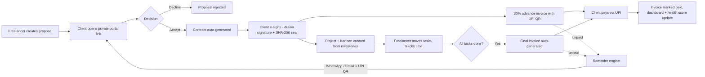
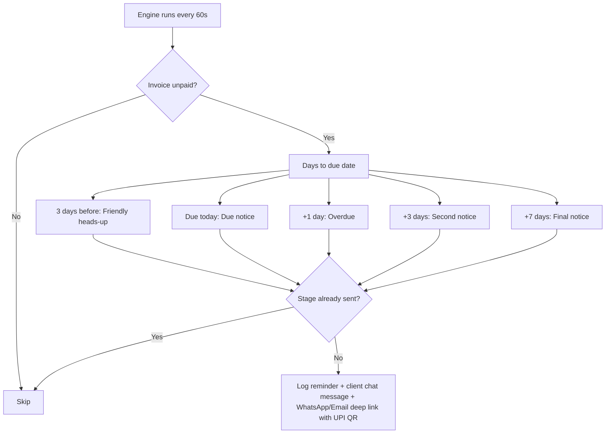
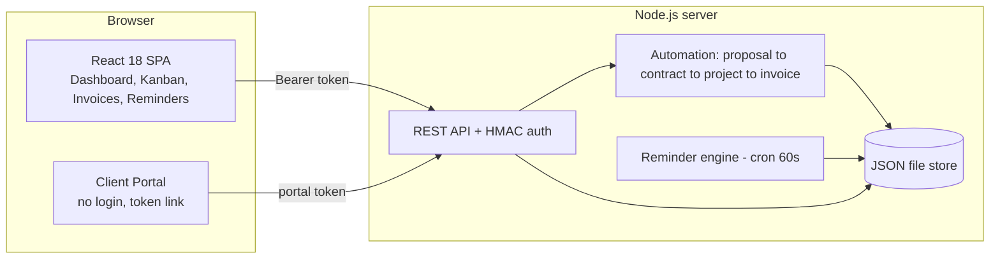

# 💼 FreelanceOS — Unified Freelancer Workspace
**SPHINX '26 · Problem Statement 1.5** · Working full-stack prototype (React + Node.js)

**Live demo:** https://freelanceos-i62i.onrender.com/

> **Demo login:** `admin@freelanceos.in` / `demo123`
> **Client portal demo (no login):** `/#/portal/meera-demo` · `/#/portal/aarav-demo`

## 1. Problem Statement
> Freelancers juggle separate tools for proposals, invoices, time tracking, contracts and client chat, and often chase late payments manually.

**Target users:** freelancers, creators, small agencies.
**Bonus twist:** client portal with **e-sign** and **progress tracking**.

## 2. Our Solution
One web app where the whole freelance lifecycle is **connected and automated**: a client accepts a proposal → a contract is generated → client e-signs → project board + advance invoice appear automatically → finishing the work auto-generates the final invoice → UPI payment links and escalating reminders collect the money.

| Problem-statement line | Where it lives in FreelanceOS |
|---|---|
| Proposals | Proposals page; client accepts/declines inside the portal |
| Invoices (auto-generated) | Advance invoice on signing, final invoice when all tasks are done, plus manual invoices with live preview + PDF |
| Time tracking | Timer / manual minutes per project + **effective hourly rate** |
| Contracts | Auto-generated from the accepted proposal, SHA-256 sealed on signing |
| Client chat | Real-time-ish chat (8s polling) between freelancer and client portal, with system events |
| Project boards | Kanban (To-do / In progress / Completed) per project |
| UPI payment links | `upi://pay?...` deep link **+ QR code** on every invoice, portal and PDF |
| Automated payment reminders | Server-side escalation engine (runs every minute) + WhatsApp/Email one-tap outbox |
| Single web app | React front-end + Node.js API in one deployable service |
| Stack: React, Node.js | ✅ React 18 + Node.js. DB/payment gateway intentionally mocked for the prototype (see §7) |
| **Bonus: client portal, e-sign, progress tracking** | ✅ Private tokenised portal: proposals, drawn-signature e-sign, live progress timeline, invoices, chat |

## 3. Unique features (beyond the brief)
1. **Zero-touch pipeline** – proposal → contract → project (milestones become tasks) → advance invoice → final invoice, all automatic.
2. **Tamper-evident e-sign** – drawn signature + typed name + timestamp + IP, sealed with a SHA-256 hash of the contract text.
3. **Escalating reminder ladder** – friendly → due → overdue → firm → final, each message carries the UPI QR/link; includes a *fast-forward days* switch for live demos.
4. **Client Payment Health score** – instantly shows whom to chase first.
5. **Effective hourly rate** – budget ÷ tracked hours per project.
6. **Per-client private portal links** – no client sign-up friction.
7. **Live activity feed** and system messages dropped into the client chat.

## 4. Flowcharts

### 4.1 End-to-end lifecycle


### 4.2 Payment reminder ladder


### 4.3 Architecture


## 5. Run locally
```bash
node server.js          # Node 18+, no npm install needed (zero dependencies)
# open http://localhost:3000
```
Reset demo data any time: delete `data/db.json` and restart.

## 6. Deploy
**Render (recommended, free):** push to GitHub (`./push-to-github.sh <repo-url>`) → Render → *New → Blueprint* → pick repo (uses `render.yaml`).
**Railway / Fly / any Docker host:** `Dockerfile` included. **Heroku-style:** `Procfile` included.
Set `BASE_URL`/`SECRET` env vars if desired. Free tiers have ephemeral disks → data resets on redeploy, which is fine for a prototype.

## 7. Prototype scope & roadmap (honest notes)
- **Storage:** JSON file instead of MongoDB for zero-setup deploys. All data access is in `server.js` behind `db`, so swapping to MongoDB is a contained change.
- **Payments:** UPI links/QR are real `upi://` deep links; the "simulate payment" button is a test-mode stand-in for a **Razorpay/Stripe webhook** (next step).
- **Reminders:** generated and logged by the engine; delivery is via one-tap WhatsApp/Email deep links. Next: SMTP / WhatsApp Business API.
- **Auth:** single demo freelancer account; multi-user signup is next.
- **Contract e-sign:** simple electronic signature with audit hash; production would add OTP/Aadhaar eSign.

## 8. Judge demo script (2 minutes)
1. Log in → Dashboard (earnings, overdue alert, client health).
2. **Proposals** → open Aarav's portal → **Accept** → **draw signature & sign**.
3. Back in the dashboard: new project, advance invoice and activity appeared automatically.
4. **Reminders** → set *fast-forward* to `8` → *Run engine* → outbox fills → click **WhatsApp**.
5. **Projects** → move all tasks to Completed → **final invoice auto-generated**.
6. Client portal → scan the UPI QR / click *simulate payment* → earnings update.

## 9. Tech
React 18 + htm (no build step) · Node.js `http` (zero deps) · qrcode-generator (CDN) · JSON store.
Front-end libraries load from public CDNs, so the demo machine needs internet.
